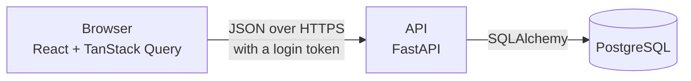

# Hotel Rate & Booking Manager

A full stack web app for running a small hotel group: manage hotels, room types and prices,
check which rooms are free, and take or cancel bookings. Admins and staff see different controls.

**Live demo: [hotel-booking-manager.vercel.app](https://hotel-booking-manager.vercel.app)**
· API docs: [hotel-booking-manager-api-u82i.onrender.com/docs](https://hotel-booking-manager-api-u82i.onrender.com/docs)

> The API runs on a free plan that sleeps when nobody is using it. The first visit after a quiet
> spell can take up to a minute while it wakes up; after that it's fast.

| Front end | Back end | Database | Tooling |
| --- | --- | --- | --- |
| React 19, TypeScript, TanStack Query, TanStack Table, React Router, Tailwind CSS, Zod | Python, FastAPI, Pydantic, JWT (PyJWT), Argon2 | PostgreSQL, SQLAlchemy, Alembic | Docker Compose, pytest, Vitest, Testing Library |

## Try it

Open the [live demo](https://hotel-booking-manager.vercel.app) and use a one-click demo account:

| Role | Email | Password | What they can do |
| --- | --- | --- | --- |
| Admin | `admin@demo.dev` | `admin-demo-2026` | Everything: add and edit hotels, room types and prices |
| Staff | `staff@demo.dev` | `staff-demo-2026` | See everything; create and cancel bookings |

## What it does

- **Dashboard** with occupancy tonight, today's arrivals, upcoming bookings and revenue for the next 30 days.
- **Data grids** you can sort by any column, search, and filter by hotel and status.
- **Bookings that respect real availability.** The server checks capacity and the busiest night of
  the stay, and prices the booking from the chosen rate.
- **No double-booking.** Booking locks the room type in the database while it saves, so two
  people can't take the last room at the same moment. Tested with 10 simultaneous requests for
  one room: exactly 1 succeeded.
- **Instant feedback.** Cancelling updates the table immediately (an optimistic update) and undoes
  itself if the server says no.
- **Sign-in with roles.** Passwords are hashed with Argon2; the server issues a signed token (JWT)
  and checks the role on every request.
- **Self-documenting API.** Every endpoint is listed and callable at `/docs`.
- **Accessible.** Labelled form fields, keyboard-friendly dialogs, sortable table headers announced
  to screen readers.

## How it fits together



| Part | Hosted on |
| --- | --- |
| Front end (static React build) | Vercel |
| API (Docker container) | Render, Singapore |
| Database | Neon PostgreSQL, Singapore |

### Project layout

```
backend/
  app/
    main.py        starts the API, allows the front end to call it
    models.py      the database tables
    schemas.py     what each request and response looks like
    routers/       the endpoints: auth, hotels, room types and rates, bookings, stats
    services.py    the availability rule (busiest night of a stay)
    security.py    password hashing and login tokens
    deps.py        "who is calling?" and role checks
    seed.py        demo data
  alembic/         database migrations (history of table changes)
  tests/           pytest suite
frontend/
  src/
    pages/         one file per screen
    components/    reusable UI: buttons, dialogs, the data table
    lib/api.ts     every request goes through here
    lib/queries.ts all server data (TanStack Query), incl. the optimistic cancel
docs/
  LEARNING_GUIDE.md   how every part works, in plain language
```

### API endpoints

| Method | Path | Who | Does |
| --- | --- | --- | --- |
| POST | `/api/auth/login` | anyone | email + password → login token |
| GET | `/api/auth/me` | signed in | who am I |
| GET | `/api/hotels` · `/api/hotels/{id}` | signed in | list hotels · one hotel with rooms and rates |
| POST · PUT · DELETE | `/api/hotels`, `/api/room-types`, `/api/rate-plans` | admin | manage hotels, rooms and prices |
| GET | `/api/room-types/{id}/availability` | signed in | rooms free for a date range (max 60 nights) |
| GET | `/api/bookings?hotel_id=&status=` | signed in | bookings, filtered |
| POST | `/api/bookings` · `/api/bookings/{id}/cancel` | signed in | create · cancel a booking |
| GET | `/api/stats` | signed in | dashboard numbers |

## Run it on your computer

**Easiest (needs Docker Desktop):**

```bash
docker compose up --build
```

Then open <http://localhost:8080> for the app and <http://localhost:8000/docs> for the API.
Demo data loads automatically. To start over: `docker compose down -v`.

**Without Docker** (Python 3.12+, Node 22+, and a PostgreSQL database; `docker compose up db -d` gives you one):

```bash
# API
cd backend
python -m venv .venv
.venv\Scripts\activate          # macOS/Linux: source .venv/bin/activate
pip install -r requirements-dev.txt
copy .env.example .env          # macOS/Linux: cp .env.example .env
alembic upgrade head
python -m app.seed
uvicorn app.main:app --reload

# Front end (second terminal)
cd frontend
npm install
npm run dev                     # http://localhost:5173
```

## Tests

```bash
cd backend && pytest       # 16 tests: sign-in, roles, pricing, availability, double-booking rules
cd frontend && npm test    # 9 tests: data table, sign-in flow, formatting
```

## Design decisions

- **Busiest night, not overlap count.** Two short stays on different nights both overlap a long
  stay but never use two rooms at once, so availability is the busiest night in the range. The
  calculation's cost depends on the number of bookings, not the length of the range.
- **Price is saved on the booking.** Changing a rate later doesn't change what existing guests pay.
- **Validate in three places.** The form checks input instantly (Zod), the API checks it again
  (Pydantic), and the database has rules (CHECK constraints) as the final safety net.
- **Safe deletes.** A hotel, room type or rate with bookings can't be deleted (the API answers 409).

---

Built by [Manikanta Sriram](https://manikantasriram.vercel.app) ·
[LinkedIn](https://www.linkedin.com/in/manekanttasriram/) · [GitHub](https://github.com/manikantasriram)
