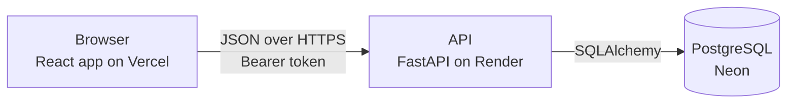

# Hotel Rate & Booking Manager

A web app for running a small hotel group. Admins set up hotels, room types and nightly rates; staff check which rooms are free and take or cancel bookings. The server prevents overbooking, even when two people try to book the last room at the same moment.

**Live demo:** [hotel-booking-manager.vercel.app](https://hotel-booking-manager.vercel.app)
**API docs:** [hotel-booking-manager-api-u82i.onrender.com/docs](https://hotel-booking-manager-api-u82i.onrender.com/docs)
**Source:** [github.com/manikantasriram/hotel-booking-manager](https://github.com/manikantasriram/hotel-booking-manager)

The API runs on Render's free plan, which sleeps after a quiet spell. The first request after that can take up to a minute; the sign-in page says so if it happens.

## Try it

Open the live demo and pick a demo account on the sign-in page (it fills in the form for you):

| Role | Email | Password | Can do |
| --- | --- | --- | --- |
| Admin | `admin@demo.dev` | `admin-demo-2026` | Everything staff can, plus add, edit and delete hotels, room types and rates |
| Staff | `staff@demo.dev` | `staff-demo-2026` | View hotels, rates, bookings and the dashboard; create and cancel bookings |

These are public demo logins seeded into the demo database, not real credentials.

## Features

- A dashboard with occupancy tonight, today's arrivals, upcoming bookings and revenue booked for the next 30 days.
- Hotel and booking tables you can sort by any column, search, and filter by hotel and status.
- A booking form that shows the price and live availability for the chosen room and dates before you confirm.
- Cancelling a booking updates the table straight away (an optimistic update) and rolls back if the server refuses.
- Role-based access: the API checks the caller's role on every request, and the interface hides admin-only controls from staff.
- Keyboard and screen-reader support: labelled fields, a skip link, focus outlines, native dialogs and announced sort order. Checked with axe-core at 375, 768 and 1440 px.

## Tech stack

| Layer | Tools |
| --- | --- |
| Front end | React 19, TypeScript, Vite, TanStack Query, TanStack Table, React Router, Zod, Tailwind CSS 4 |
| Back end | Python 3.14, FastAPI, Pydantic, SQLAlchemy 2, Alembic, PyJWT, Argon2 (pwdlib) |
| Database | PostgreSQL (Neon in production, Postgres 18 in Docker Compose) |
| Testing | pytest, Vitest, Testing Library |
| Hosting | Vercel (front end), Render (API, Docker), Neon (database) |

## Architecture



The front end is a static build. It signs in by posting the email and password to `/api/auth/login`, stores the returned JWT and sends it as a `Bearer` header with every request. The API keeps no sessions: it verifies the token's signature, loads the user and checks their role. All business rules (pricing, capacity, availability, overbooking) run on the server.

```
backend/
  app/
    main.py         creates the app: CORS, security headers, error handling, routers
    config.py       settings read from environment variables
    models.py       database tables
    schemas.py      request and response shapes, with validation
    routers/        endpoints: auth, hotels, room types and rates, bookings, stats
    services.py     the availability calculation
    security.py     password hashing and tokens
    ratelimit.py    limit on failed sign-ins
    deps.py         "who is calling?" and role checks
    seed.py         demo data
  alembic/          database migrations
  tests/            pytest suite
frontend/
  src/
    pages/          one file per screen
    components/     shared UI: buttons, form fields, dialog, data table
    lib/api.ts      every request goes through here
    lib/queries.ts  server data with TanStack Query
docs/
  LEARNING_GUIDE.md a walkthrough of how each part works
```

## How availability and locking work

A room type (for example "Deluxe King") has a number of identical rooms. A booking takes one of them for a range of nights.

**Availability is the busiest night of the stay.** Two bookings overlap when one starts before the other ends, so checking out on the morning someone else checks in is fine. Counting overlapping bookings would overstate demand: two one-night stays on different nights both overlap a four-night request but only ever use one room at a time. `services.booked_rooms` treats each overlapping booking as +1 room on its first night and -1 on its check-out day, sorts those events and keeps a running total. The highest total is the busiest night. The work grows with the number of overlapping bookings, not with the length of the date range, and availability checks are capped at 60 nights.

**Booking locks the room type row.** `POST /api/bookings` starts with `SELECT ... FOR UPDATE` on the room type. If two requests try to take the last room at once, the second waits until the first commits, then sees that booking and gets `409 sold out`. Editing a room type takes the same lock and refuses to set fewer rooms than are already booked on any night from today on. Cancelling locks the booking row, so a booking can't be cancelled twice. The test suite runs on SQLite, which ignores `FOR UPDATE`, so the locks only take effect on PostgreSQL.

Other rules the API enforces:

- The total price is fixed when the booking is made, so later rate changes don't affect it.
- The rate must belong to the chosen room type, and the guest count must fit the room's capacity.
- Check-out must be after check-in, a stay can be at most 60 nights, and check-in can't be in the past (one day of leeway covers time zones behind the server's UTC clock).
- A hotel, room type or rate that has bookings can't be deleted (`409`).
- The database repeats the main rules as CHECK constraints: stars 1 to 5, capacity and room count at least 1, price above 0, check-out after check-in.

## Security

- Passwords are stored as Argon2id hashes. Sign-in gives the same error, in about the same time, whether the email or the password is wrong, and passwords over 128 characters are rejected before hashing.
- After 10 failed sign-ins from one address within a minute, the login endpoint answers `429` with a `Retry-After` header. The counter lives in memory, which suits the single API instance on Render's free plan.
- Tokens are HS256 JWTs that expire after 8 hours by default. The secret must be at least 32 characters, and the API refuses to start on Render if `JWT_SECRET` is still the development default.
- CORS allows only the origins listed in `CORS_ORIGINS`, and only the methods the app uses.
- All database access goes through SQLAlchemy with bound parameters; no SQL is built from strings.
- API responses carry `X-Content-Type-Options`, `X-Frame-Options` and `Referrer-Policy` headers. The Vercel site also sends a Content-Security-Policy that allows only its own files and calls to the API.

## Run it locally

### With Docker Compose

Needs Docker Desktop.

```bash
docker compose up --build
```

| Service | Address |
| --- | --- |
| Web app | http://localhost:8080 |
| API and docs | http://localhost:8000/docs |
| PostgreSQL | localhost:5432 |

The API container runs the migrations and loads the demo data on first start. All ports are bound to localhost only. To wipe the database and start again: `docker compose down -v`.

### Without Docker

Needs Python 3.14, Node 24 and a PostgreSQL database. `docker compose up db -d` starts just the database from Compose.

API:

```bash
cd backend
python -m venv .venv
.venv\Scripts\activate            # macOS/Linux: source .venv/bin/activate
pip install -r requirements-dev.txt
copy .env.example .env            # macOS/Linux: cp .env.example .env, then set your own values
alembic upgrade head
python -m app.seed                # demo data; add --reset to wipe and reseed
uvicorn app.main:app --reload     # http://localhost:8000/docs
```

Front end, in a second terminal:

```bash
cd frontend
npm install
npm run dev                       # http://localhost:5173
```

## Environment variables

Set values in `backend/.env` locally (copy `backend/.env.example`) and in the Render and Vercel dashboards in production. Never commit real values.

| Variable | Used by | Purpose |
| --- | --- | --- |
| `DATABASE_URL` | API | PostgreSQL connection string. `postgres://` and `postgresql://` URLs are switched to the psycopg driver automatically. |
| `JWT_SECRET` | API | Signs login tokens. A long random string, at least 32 characters. |
| `JWT_EXPIRES_MINUTES` | API | Token lifetime. Optional, defaults to 480. |
| `CORS_ORIGINS` | API | Comma-separated front-end origins allowed to call the API. |
| `LOGIN_ATTEMPTS_PER_MINUTE` | API | Failed sign-ins allowed per address per minute. Optional, defaults to 10. |
| `SEED_DEMO` | API container | When `true`, `start.sh` loads demo data into an empty database. |
| `PORT` | API container | Port to listen on. Render sets it; defaults to 8000. |
| `VITE_API_URL` | Front-end build | Address of the API. It's baked into the build, so set it before building. |

## Tests

```bash
cd backend && pytest        # 25 tests
cd frontend && npm test     # 10 tests
```

The backend tests give each test a fresh in-memory SQLite database. They cover sign-in, the failed sign-in limit, roles, validation, pricing, availability (including the busiest-night rule), sold-out and back-to-back stays, cancelling, safe deletes, the room-count guard and the production secret check. The front-end tests cover the data table (search, sort, empty state), the sign-in flow, and date and money formatting.

`npm run lint` runs oxlint, and `npm run build` type-checks and builds the front end.

## Deployment

| Part | Platform | How it deploys |
| --- | --- | --- |
| Front end | Vercel | Builds `frontend/` on every push to `main`. `vercel.json` sends every path to `index.html` and sets caching and security headers. |
| API | Render | Docker service described in `render.yaml` (root `backend/`, health check `/api/health`). On start, `start.sh` runs `alembic upgrade head`, seeds demo data if `SEED_DEMO=true` and the database is empty, then starts uvicorn. |
| Database | Neon | Managed PostgreSQL. Its connection string goes into `DATABASE_URL` on Render. |

`render.yaml` asks Render to generate `JWT_SECRET`. `DATABASE_URL` and `CORS_ORIGINS` are entered by hand in the Render dashboard, and `VITE_API_URL` in the Vercel project settings.

## API

Interactive docs (Swagger UI) are at `/docs` on any running API, including the [live API](https://hotel-booking-manager-api-u82i.onrender.com/docs). Every endpoint except sign-in and the health check needs a token.

| Method | Path | Role | Purpose |
| --- | --- | --- | --- |
| POST | `/api/auth/login` | anyone | Exchange email and password (form fields `username` and `password`) for a token |
| GET | `/api/auth/me` | signed in | The current user |
| GET | `/api/hotels`, `/api/hotels/{id}` | signed in | All hotels, or one hotel with its room types and rates |
| POST, PUT, DELETE | `/api/hotels`, `/api/hotels/{id}` | admin | Manage hotels |
| POST, PUT, DELETE | `/api/room-types`, `/api/room-types/{id}` | admin | Manage room types |
| POST, PUT, DELETE | `/api/rate-plans`, `/api/rate-plans/{id}` | admin | Manage rates |
| GET | `/api/room-types/{id}/availability?check_in=&check_out=` | signed in | Rooms free for a date range |
| GET | `/api/bookings?hotel_id=&status=&from=&to=` | signed in | Bookings, optionally filtered |
| GET | `/api/bookings/{id}` | signed in | One booking |
| POST | `/api/bookings` | signed in | Create a booking |
| POST | `/api/bookings/{id}/cancel` | signed in | Cancel a booking |
| GET | `/api/stats` | signed in | Dashboard numbers |
| GET | `/api/health` | anyone | Health check |

## Roles

| | Staff | Admin |
| --- | --- | --- |
| View hotels, rates, bookings and the dashboard | Yes | Yes |
| Create and cancel bookings | Yes | Yes |
| Add, edit and delete hotels, room types and rates | No | Yes |

Roles are stored on each user and enforced by the API, which answers `403` when staff call an admin endpoint. Hiding buttons in the interface is only a convenience.

---

Built by [Manikanta Sriram](https://manikantasriram.vercel.app) · [LinkedIn](https://www.linkedin.com/in/manekanttasriram/) · [GitHub](https://github.com/manikantasriram)
