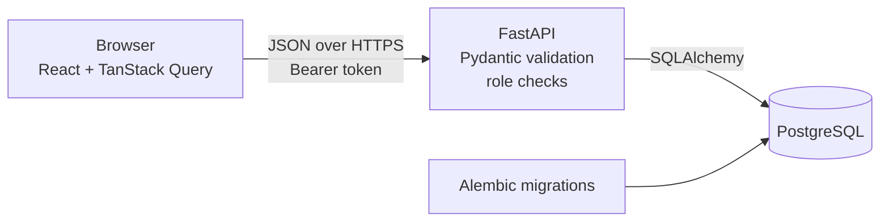

# Hotel Rate & Booking Manager

A full stack app for running a small hotel group: manage hotels, room types and rate plans, check
availability, and take and cancel bookings, with separate **admin** and **staff** roles.

**Stack:** React 19 · TypeScript · TanStack Query · TanStack Table · Tailwind CSS · FastAPI · PostgreSQL · SQLAlchemy · Alembic · JWT · Docker · GitHub Actions

<!-- Live demo links go here once deployed (Vercel front end + Render API). -->

## Try it

Sign in with either demo account (the login page has one-click buttons for both):

| Role  | Email            | Password          | Can do                                         |
| ----- | ---------------- | ----------------- | ---------------------------------------------- |
| Admin | `admin@demo.dev` | `admin-demo-2026` | everything, including hotels, rooms and prices |
| Staff | `staff@demo.dev` | `staff-demo-2026` | view everything; create and cancel bookings    |

## Features

- **Dashboard:** occupancy tonight, today's arrivals, upcoming bookings and revenue for the next 30 days.
- **Sortable, filterable data grids:** sort any column, search across rows, and filter bookings by hotel and status.
- **Bookings with real availability:** the server checks every night of the stay against the rooms
  already booked, enforces room capacity, and prices the stay from the chosen rate plan.
- **No overbooking, even under load:** creating a booking locks the room type's row
  (`SELECT … FOR UPDATE`), so two people booking the last room at the same moment can't both win.
  Tested: 10 simultaneous requests for one room → exactly 1 booking, 9 "sold out" responses.
- **Optimistic updates:** cancelling a booking updates the table instantly and rolls back if the
  server refuses.
- **JWT auth with role-based access:** Argon2-hashed passwords, signed tokens, and per-endpoint role
  checks (admins manage inventory; staff handle bookings).
- **Documented REST API:** interactive OpenAPI docs at `/docs`, generated from the code.
- **Accessible UI:** labelled form fields, keyboard-friendly dialogs and tables (`aria-sort`), visible focus.

## Architecture



```
backend/
  app/
    main.py          app setup, CORS, routers
    models.py        database tables (SQLAlchemy ORM)
    schemas.py       request/response shapes (Pydantic)
    security.py      password hashing and JWTs
    deps.py          "who's calling?" and role checks
    services.py      availability rule (busiest night of a stay)
    routers/         auth, hotels, room types & rate plans, bookings, stats
    seed.py          demo data
  alembic/           database migrations
  tests/             pytest suite (runs on SQLite in memory)
frontend/
  src/
    lib/api.ts       fetch wrapper: base URL, token, readable errors
    lib/queries.ts   all server data via TanStack Query (incl. the optimistic cancel)
    components/      UI kit, DataTable (TanStack Table), layout
    pages/           dashboard, hotels, hotel detail, bookings, new booking, login
```

### API at a glance

| Method | Path                                     | Who   | What                                  |
| ------ | ---------------------------------------- | ----- | ------------------------------------- |
| POST   | `/api/auth/login`                        | all   | email + password → JWT                |
| GET    | `/api/auth/me`                           | staff | the signed-in user                    |
| GET    | `/api/hotels`, `/api/hotels/{id}`        | staff | hotels; one hotel with rooms and rates |
| POST/PUT/DELETE | `/api/hotels…`                  | admin | manage hotels                         |
| POST/PUT/DELETE | `/api/room-types…`, `/api/rate-plans…` | admin | manage rooms and prices         |
| GET    | `/api/room-types/{id}/availability`      | staff | rooms free for a date range           |
| GET    | `/api/bookings?hotel_id=&status=&from=&to=` | staff | bookings, filtered                 |
| POST   | `/api/bookings`                          | staff | create a booking                      |
| POST   | `/api/bookings/{id}/cancel`              | staff | cancel a booking                      |
| GET    | `/api/stats`                             | staff | dashboard numbers                     |

Full, interactive docs: run the API and open <http://localhost:8000/docs>.

## Run it locally

### With Docker (one command)

```bash
docker compose up --build
```

- App: <http://localhost:8080>
- API docs: <http://localhost:8000/docs>

The API applies migrations and loads demo data on start-up. To start again from scratch:
`docker compose down -v`.

### Without Docker

Needs Python 3.12+, Node 22+ and a PostgreSQL database (the Docker one is easiest:
`docker compose up db -d` and set `DATABASE_URL` accordingly, or run Postgres yourself).

```bash
# API
cd backend
python -m venv .venv
.venv/Scripts/activate            # macOS/Linux: source .venv/bin/activate
pip install -r requirements-dev.txt
cp .env.example .env              # then edit DATABASE_URL / JWT_SECRET
alembic upgrade head
python -m app.seed
uvicorn app.main:app --reload     # http://localhost:8000/docs

# Front end (new terminal)
cd frontend
npm install
npm run dev                       # http://localhost:5173
```

## Tests

```bash
cd backend && pytest              # API: auth, roles, pricing, availability, overbooking rules
cd frontend && npm test           # UI: data table, login flow, formatting
```

Both suites run on every push in GitHub Actions (`.github/workflows/ci.yml`).

## Deployment

- **Database:** PostgreSQL on [Neon](https://neon.com) (free tier).
- **API:** Docker web service on [Render](https://render.com) (free tier, see `render.yaml`).
  Free services sleep when idle, so the first request after a quiet spell can take up to a minute.
- **Front end:** static build on [Vercel](https://vercel.com) with `VITE_API_URL` pointing at the API.

## Design decisions

- **Availability is checked night by night.** Two short stays on different nights both overlap a
  long stay but only ever use one room at a time, so the check takes the busiest night, not a
  simple count of overlapping bookings.
- **The price is stored on the booking.** Changing a rate plan later doesn't change what existing
  guests pay.
- **Rules live on the server; the UI repeats them for speed.** Zod validates forms instantly, but
  the API validates everything again, and the database has CHECK constraints as a final guard.
- **Deleting is guarded.** A hotel, room type or rate plan with bookings can't be deleted (409).

---

Built by [Manikanta Sriram](https://manikantasriram.vercel.app).
